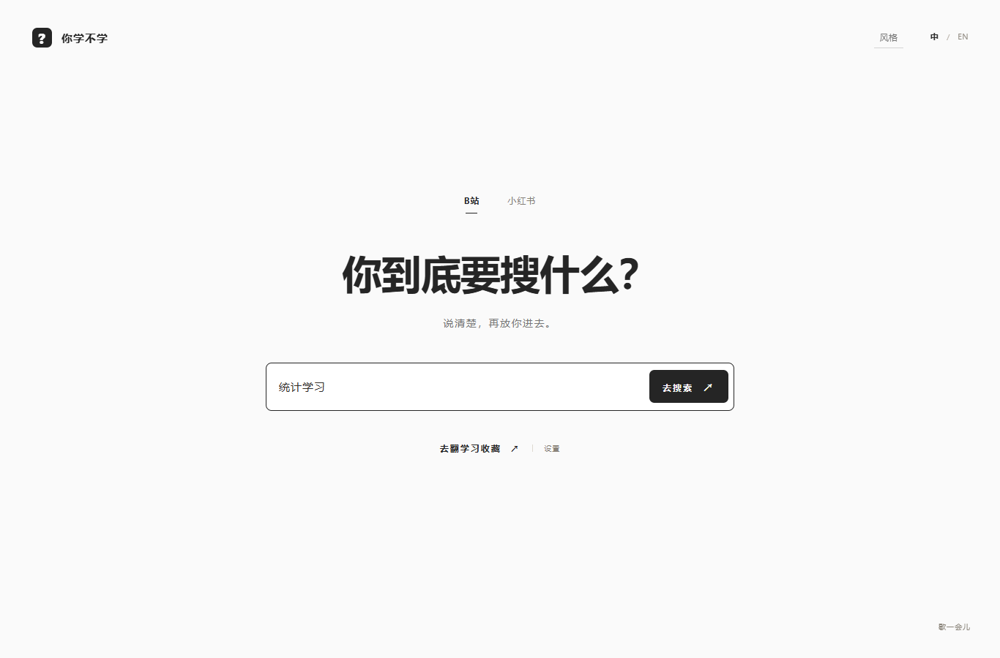

# intentional-browsing

**不入流｜B站 / 小红书首页去推荐插件**

跳过首页推荐流，直达搜索和自己的收藏夹。

[English](README.en.md) · [安装方法](docs/INSTALL.md) · [使用与常见问题](docs/USAGE.md) · [隐私说明](PRIVACY.md)

将 B站和小红书网页版首页替换为简洁入口，提供关键词搜索、收藏夹快捷入口和限时放行，减少首页推荐带来的干扰。

这是一个**电脑端 Chrome / Edge 浏览器扩展**，同时支持 B站和小红书网页版。当前版本为 **1.0.0**，采用 [MIT 许可证](LICENSE)。手机 App 不适用。

## 能做什么

- **纯净首页**：访问 B站或小红书首页时，进入扩展的搜索入口。
- **直接搜索**：输入关键词，打开原站搜索结果，继续在原站看视频或笔记。
- **收藏夹快捷入口**：保存已有网课收藏夹、列表或合集的链接，下次快速打开；不会替你收藏视频或笔记。
- **限时放行**：选择 1–180 分钟临时恢复原站首页；到期或主动结束后，首页回到纯净入口，搜索、视频和收藏页保持打开。界面按钮为「休息一下」或「歇一会儿」。
- **三种风格**：在同一个插件里切换，收藏、语言和计时状态共用。
- **中 / EN**：可切换界面语言，自己写的留言保留原文。

## 三种风格

| 风格 | 感觉 |
| --- | --- |
| 知止 Still | 暖白、留白和宋体，安静一点。 |
| 你学不学！ | 黑白灰、粗体，直接问你到底要搜什么。 |
| 同桌 | 像收到朋友的一条短信，名字和留言都能自己填。 |

看看「你学不学！」

看看「同桌」

默认示例：小明：大不了你就二战呗。名字最多 24 个字符，留言最多 160 个字符，可换行；不随机、不轮换。

点击浏览器工具栏里的插件图标，或入口右上角的「风格」，即可切换。

## 安装

1. 从 [v1.0.0 下载页](https://github.com/SweetPotato3553/intentional-browsing/releases/tag/v1.0.0) 下载 [intentional-browsing-chromium-1.0.0.zip](https://github.com/SweetPotato3553/intentional-browsing/releases/download/v1.0.0/intentional-browsing-chromium-1.0.0.zip)，解压到一个固定位置。
2. 在浏览器地址栏打开 `chrome://extensions`（Chrome）或 `edge://extensions`（Edge）。
3. 打开「开发者模式」，点击「加载已解压的扩展程序」或「加载解压缩的扩展」。
4. 选择解压后**里面的 `extension` 文件夹**，其中应能看到 `manifest.json`。
5. 刷新已经打开的 B站 / 小红书页面，访问首页即可使用。

安装后请保留这个文件夹。也可以点 **Code → Download ZIP**，解压后加载源码中的 `extension` 文件夹，无需先构建。

详细图文路径、目录示例和更新方法见 [安装说明](docs/INSTALL.md)。

## 设置收藏夹快捷入口

点击入口的「打开收藏」或旁边的「设置」，再选择「去 B站 / 小红书找收藏夹」（设置收藏夹快捷入口）。会打开一个临时设置页：进入自己的具体收藏夹后，点击浮窗上的「保存此页」。

设置窗口限时 **3 分钟**，浮窗可以拖动、收起。小红书请选择自己的个人主页，插件会构造收藏页地址；能否查看收藏由原站权限决定。也可以在设置框里手工粘贴收藏地址。

登录遇到问题时，入口提供原站登录与最多 **5 分钟**的备用登录窗口。插件不代替原站登录，也不会索取你的账号密码。

## 隐私与权限

没有广告、遥测或开发者数据上传。收藏、风格、语言和留言保存在扩展本地；待恢复搜索和临时截止时间使用浏览器会话存储。搜索与登录仍会访问 B站 / 小红书自己的服务。

扩展仅申请所支持的 B站 / 小红书域名访问权限，用于首页接管、识别登录与收藏页及显示浮窗。`storage` 用于保存设置和临时状态，`alarms` 用于计时到期处理，`declarativeNetRequestWithHostAccess` 让浏览器按规则将首页导航转到纯净入口，并在设定时段临时放行。登录和收藏识别还会由内容脚本查看相关页面元素；数据不上传给开发者。详见 [PRIVACY.md](PRIVACY.md)。

## 兼容性与已知边界

- 面向桌面 Chrome / Edge，要求 Chromium 120 或以上。已在 Windows Edge 上完成模拟站点自动化验证；其他满足最低版本的 Chromium 浏览器预计兼容，欢迎反馈兼容性问题。
- 原站改版、网络故障、扫码、验证码或风控可能影响登录与收藏识别。
- 系统睡眠或浏览器关闭期间，计时回调可能延后；恢复后按原截止时间检查。
- 这是减少首页干扰的小工具，仍可关闭扩展或使用限时放行。

发现问题可以提交 Issue。请附浏览器版本、平台、复现步骤和去除个人信息的截图；不要贴 Cookie、访问令牌或完整的私人收藏地址。

## 源码、构建与验证

本项目使用 OpenAI Codex 辅助开发。

运行时代码是原生 JavaScript / HTML / CSS，无第三方运行时依赖。源码在 [`extension/`](extension/)，测试与打包方法见 [开发说明](docs/DEVELOPMENT.md)。

1.0.0 发布前通过 **86 个模拟站点测试场景**，包括三种风格、登录、收藏、浮窗和故障恢复。这不等同于真实账号扫码或验证码的端到端验证。原始记录见 [`VERIFICATION.json`](VERIFICATION.json) 和 [发布审查记录](RELEASE-REVIEW.md)。本次 GitHub 整理不改变扩展运行时代码。

[更新记录](CHANGELOG.md) · [参与贡献](CONTRIBUTING.md) · [安全问题](SECURITY.md) · [MIT License](LICENSE)
